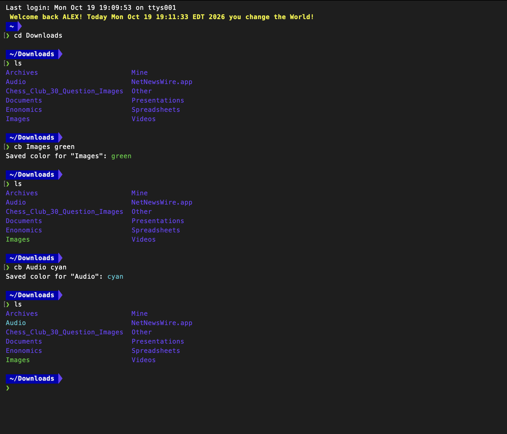
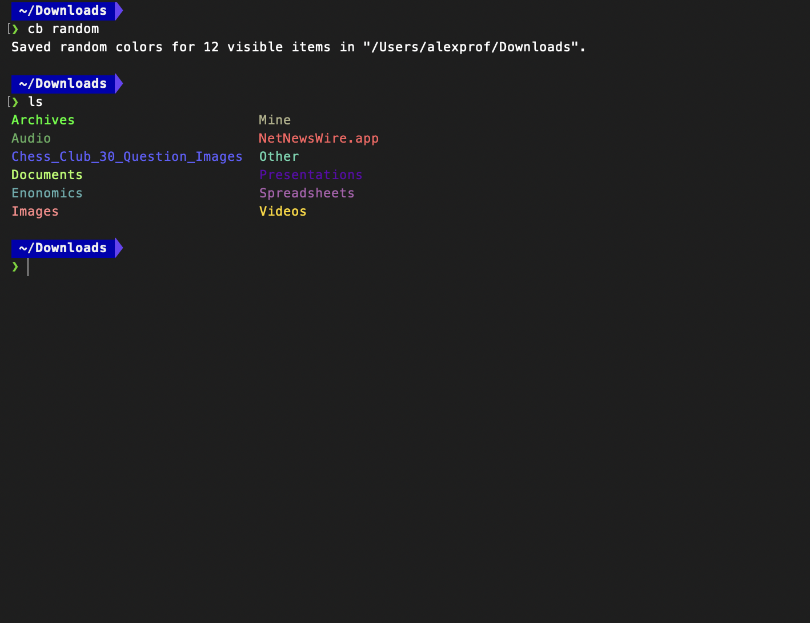

# colorBash

Give specific files and folders their own colors in `ls` output.

Save colors by exact name, or use `cb random` to color the visible items in the
current directory. Works in Bash and Zsh on macOS and Linux. On Windows, use
Git Bash or WSL, not native PowerShell or Command Prompt.

## In use

Assign colors to individual names with `cb Images green` and `cb Audio cyan`:



Use `cb random` to assign colors to visible files and folders in the current directory:



## Install from source

Requires Git and a Bash-compatible shell. Run these commands in Bash or Zsh
(Git Bash or a WSL shell on Windows):

```sh
git clone https://github.com/alexprofmutua/colorBash.git
cd colorBash
./install.sh --configure-shell
```

The installer puts the commands in `~/.local/bin` and adds a managed block to
your shell startup file. Open a new terminal afterward, or source the file
printed by the installer.

To choose the startup file explicitly:

```sh
./install.sh --configure-shell --shell-rc "$HOME/.zshrc"
```

For Bash, use the file your shell loads, such as `~/.bashrc` or `~/.bash_profile`.
To install without changing shell configuration, run `./install.sh`, add
`~/.local/bin` to your `PATH`, and add `eval "$(colorbash init)"` to that file.

## Usage

```sh
cb Documents blue
cb "My Projects" '#ff7a00'
cb logs 214
ls
```

| Command | What it does |
| --- | --- |
| `cb <name> <color>` | Save a color for an exact file or folder name |
| `cb random` | Save random colors for visible items in the current directory |
| `cb list` | Show saved rules |
| `cb remove <name>` | Remove the matching rule in the current directory context |
| `cb clear` | Delete all saved color rules |
| `cb help` | Show commands and supported colors |

Colors include ANSI names, bright variants, extra names such as `orange` and
`teal`, palette numbers from 0 to 255, and `#RRGGBB` hex values.

## How it works

Shell integration wraps `ls` for supported interactive forms: `ls`, `ls -a`,
`ls -A`, and `ls -1`. Other options and non-terminal output pass through to the
system command. Use `command ls` to bypass the wrapper.

Rules live in `~/.config/colorbash/rules.tsv`. Exact-name rules apply across
directories; random rules are scoped to the directory where they were created.
colorBash changes how names are displayed, not the files themselves. It runs
without a background service.

## Uninstall

From the cloned repository:

```sh
./uninstall.sh
```

Add `--purge-config` only if you also want to delete saved color rules.

## License

[GNU Affero General Public License v3.0](LICENSE). Separate commercial licensing
is described in [LICENSING.md](LICENSING.md).
