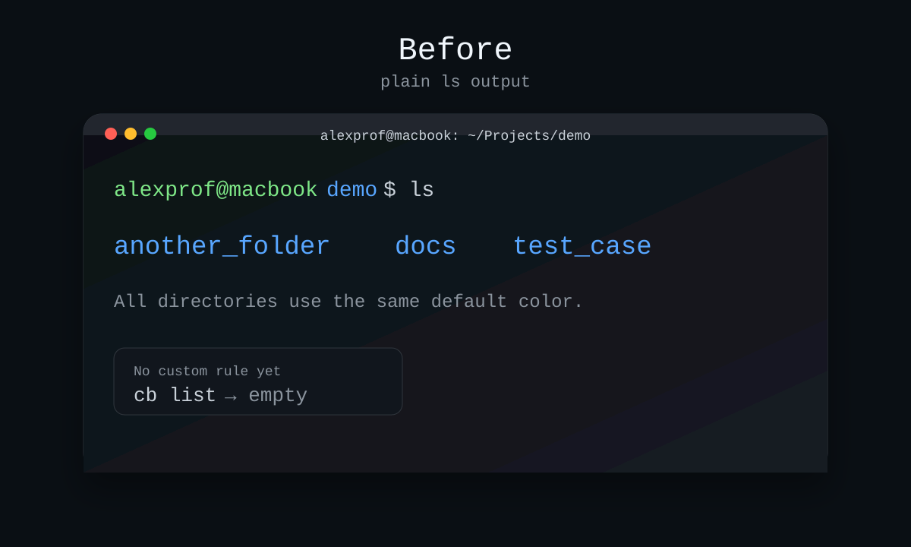
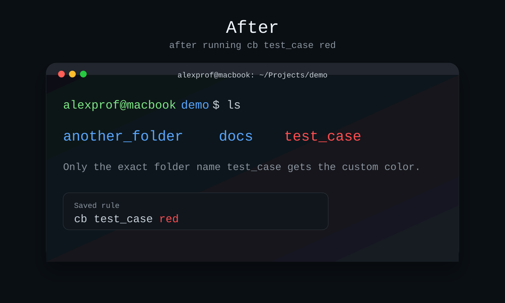

# colorbash

`colorbash` lets you color one exact folder name differently in your terminal `ls` output.

macOS `ls` only colors by file type, not by exact name, so this project solves that by:

- saving folder-name color rules with `cb <name> <color>`
- wrapping plain interactive `ls` so your chosen folder name gets its own color

## Preview

### Before



### After



These images are simple mockups of the terminal output, so your exact font, spacing, and colors may vary a little depending on your shell theme.

## Install

### Homebrew

After the release asset and tap repo are published, install with:

```bash
brew install amm22-lab/colorbash/colorbash
echo 'eval "$(colorbash init)"' >> ~/.zshrc
source ~/.zshrc
```

### Fastest local install

If someone downloads this project as a zip, tarball, or git clone, they can install it with:

```bash
chmod +x install.sh
./install.sh --configure-shell
```

That installs `colorbash` and `cb` into `~/.local/bin` by default and adds a managed shell block with:

```bash
eval "$(colorbash init)"
```

### Manual install

If you prefer to do it yourself:

```bash
chmod +x colorbash cb
export PATH="/path/to/colorBash:$PATH"
eval "$(colorbash init)"
```

### Uninstall

```bash
chmod +x uninstall.sh
./uninstall.sh
```

## Usage

Set a custom color for one folder name:

```bash
cb test_case red
```

Use a hex color:

```bash
cb test_case '#ff7a00'
```

Use a 256-color code:

```bash
cb test_case 214
```

Show saved rules:

```bash
cb list
```

Remove one rule:

```bash
cb remove test_case
```

Clear every saved rule:

```bash
cb clear
```

## Supported Colors

- Named colors: `black`, `red`, `green`, `yellow`, `blue`, `magenta`, `cyan`, `white`
- Bright colors: `bright-red`, `bright-blue`, `bright-cyan`, and similar
- 256-color palette values: `0` through `255`
- Hex values: `#RRGGBB`

## How It Works

After you add `eval "$(colorbash init)"` to your shell config:

- `cb` stores exact folder-name color rules in `~/.config/colorbash/rules.tsv`
- `ls` is wrapped for simple interactive use in the current directory
- unsupported `ls` modes fall back to your normal system `ls`

## Current Scope

The custom coloring is applied for interactive:

- `ls`
- `ls -a`
- `ls -A`
- `ls -1`

Other `ls` forms fall back to the native command so your normal workflow stays safe.

## Distribution

The easiest way to share `colorbash` is:

1. publish this repo on GitHub
2. create a release archive with `./scripts/package-release.sh`
3. upload the generated `dist/colorbash-vX.Y.Z.tar.gz` file to a GitHub Release
4. tell users to download the archive and run `./install.sh --configure-shell`

### Homebrew

Once you have a public GitHub repo and release tarball:

1. run `./scripts/package-release.sh`
2. copy the printed SHA256 value
3. generate a formula with:

```bash
./scripts/generate-homebrew-formula.sh <github-owner> <repo> <version> <sha256>
```

That writes [Formula/colorbash.rb](/Users/alexprof/Projects/colorBash/Formula/colorbash.rb), which you can place in your Homebrew tap repository.

For the full GitHub release and Homebrew tap workflow, see [PUBLISHING.md](/Users/alexprof/Projects/colorBash/PUBLISHING.md).

## License

This project is available under the GNU Affero General Public License v3.0 in [LICENSE](/Users/alexprof/Projects/colorBash/LICENSE).

If you want to use `colorbash` without AGPLv3 obligations, a separate commercial license may be available from Alex Mutua. Contact: `alexmusyoki834@gmail.com`. See [LICENSING.md](/Users/alexprof/Projects/colorBash/LICENSING.md).
